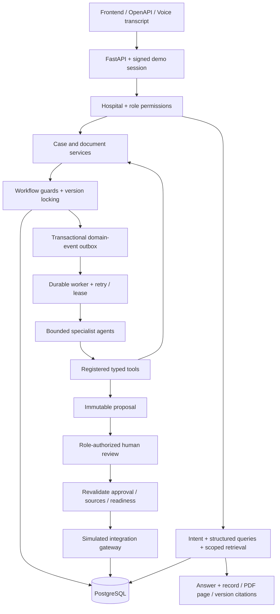

# Architecture and execution boundaries

CareFlow is a modular monolith with one asynchronous API, one PostgreSQL database, and one independently run worker. Domain operations are ordinary typed Python services. Eight specialist agent definitions call only registered tools. The default provider performs deterministic checks against persistent synthetic records.

`models.py` owns the relational schema. `services.py`, `documents.py`, and `demo.py` implement domain operations. `workflow.py` is the independent rules engine. `approvals.py` validates immutable proposals and executes approved actions. `tools.py` declares allowed tool contracts. `agents.py` is a registry and bounded orchestration layer. `worker.py` handles outbox dispatch, job claiming, transactional execution, retries and monitoring schedules. `assistant.py` performs database-grounded queries. `api.py` is the REST boundary; `main.py` adds correlation, logging and health.

## Transaction and recovery model

A case change, its event, audit entry, and outbox event are written in one transaction. The publisher atomically marks outbox entries and inserts unique event/agent jobs. Job claiming uses row locks with `SKIP LOCKED`, which [PostgreSQL documents for queue-like consumers](https://www.postgresql.org/docs/16/sql-select.html). Processing holds the claimed job lock and commits its domain writes, simulated receipt and completion together. A crash rolls back partial changes. An expired claim can be reacquired; lease tokens fence an older claimant. Retry delay is exponential, with four attempts by default and a dead-letter state.

The mock gateway has no production network client. Its receipt and state changes live in the same database transaction, so the prototype can make its local simulated effects atomic. Future live systems cannot rely on this transaction alone: adapters will need provider-supported idempotency, reconciliation and uncertain-delivery handling.

## Scope of optional AI features

Mock agents apply deterministic bounded rules; they do not perform general document understanding. PDF extraction uses embedded text and server-generated fixtures. The assistant retrieves actual authorized pages and operational state. Ollama is an optional local connectivity path with JSON output validation; this implementation accepts only an answer equal to the verified deterministic answer and falls back otherwise. It does not yet provide flexible general-language reasoning. Embeddings/pgvector and OCR are deferred. Speech is optional; no speech model is fetched during a request.

## Extensibility

Keep rules and authorization outside model providers. Introduce production gateways behind typed interfaces only after defining their idempotency and audit contracts. The present module layout is deliberately smaller than the suggested directory tree; there are no empty placeholder domain services. Domain-specific models/services can be split without changing API semantics. Enterprise identity, migrations for expanded states, patient matching and source-validation policies must precede real integrations.
